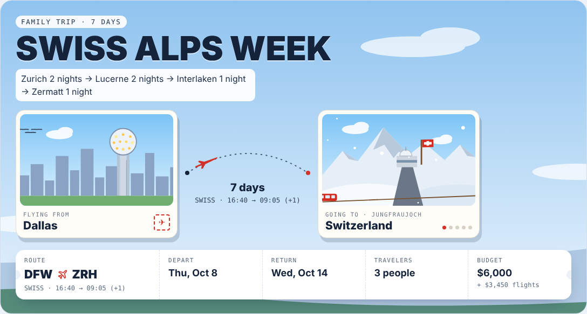
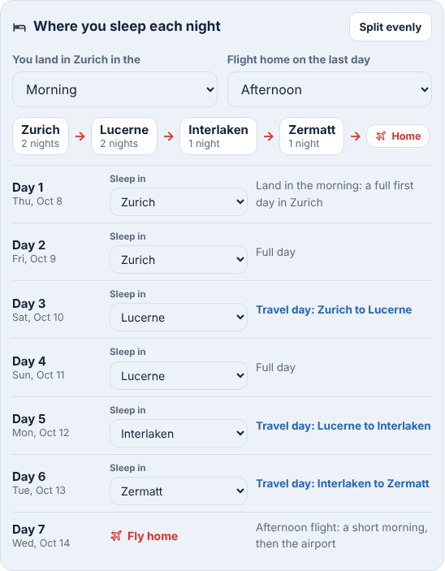
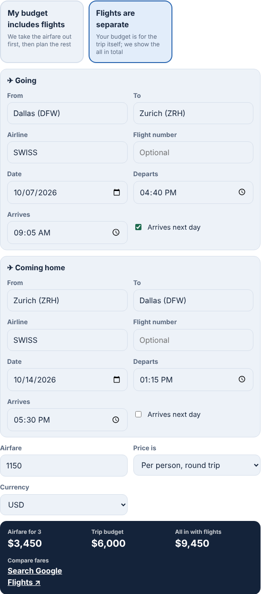
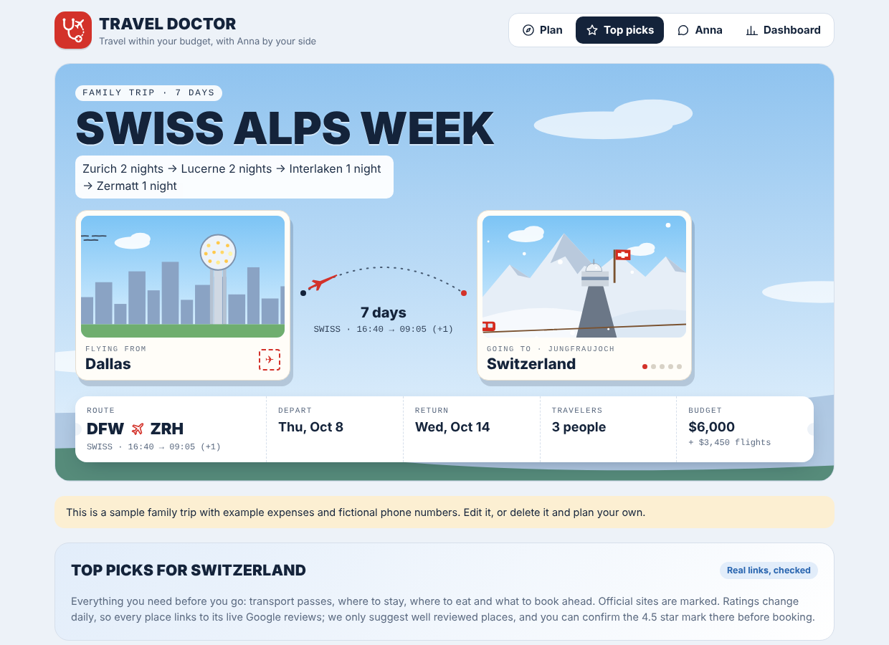
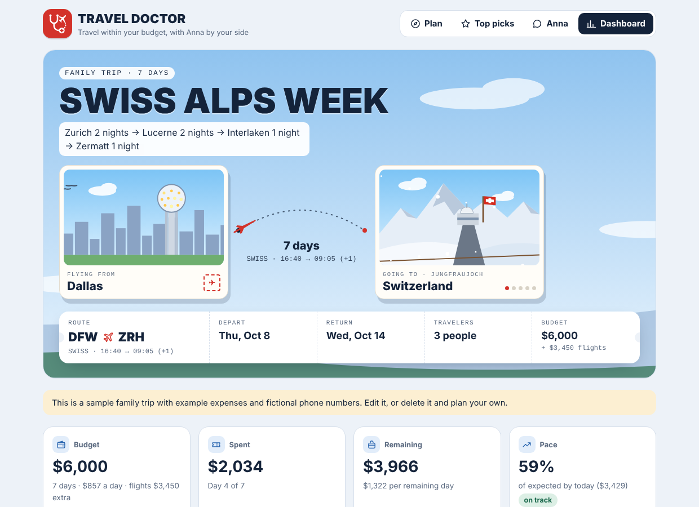
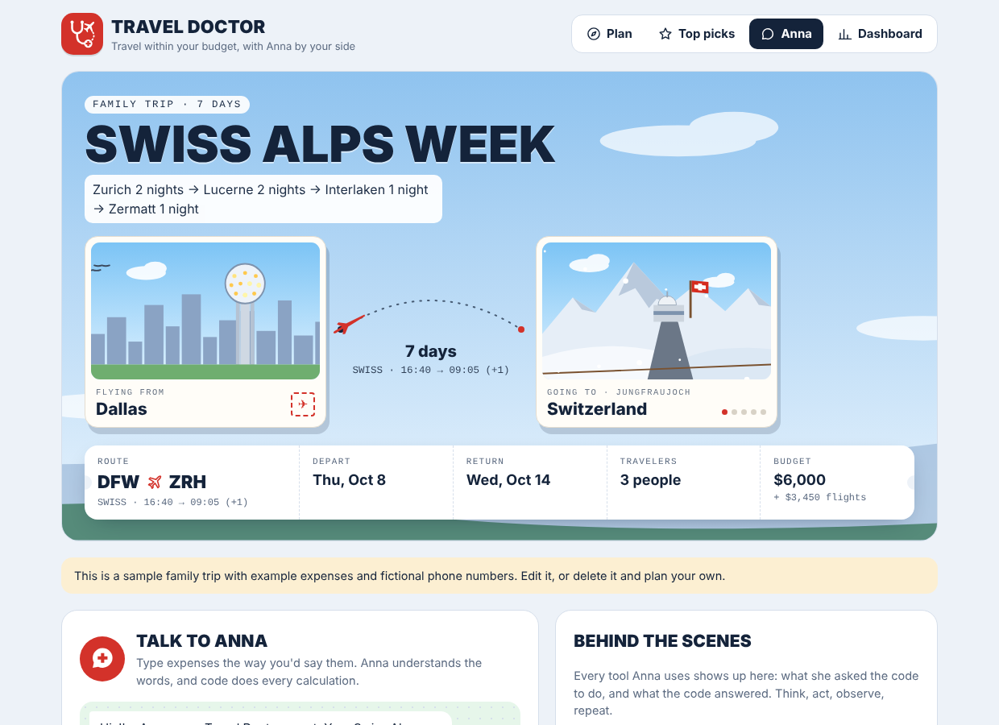
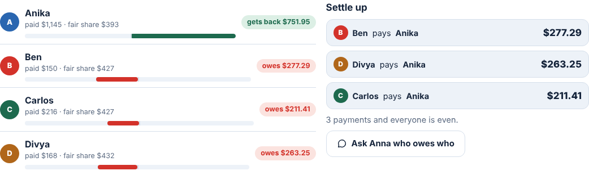

# Travel Doctor

**Travel within your budget, with Anna by your side.**

Travel Doctor is a travel budget app with an AI agent named Anna. You set up a trip, a budget and who is traveling. During the trip you tell Anna what you spent, in plain words ("dinner was 85 francs and the cable car 64"), and she logs it, converts the currency and tells you if you're on track. A dashboard shows your pace, forecast and spending by day and category. For groups of friends, it works out who owes who, like Splitwise.

Built by Swati Sharma for the Gen Academy Agentic AI Bootcamp, Week 1 project (Path C: build your own app with vibe coding). Written in JavaScript (Node.js) with no outside packages; the dataset generator and the analysis notebook are Python.



## What it does

| Feature | What you see |
|---|---|
| Trip setup | Solo, family or group; dates; home airport; budget and a "budget prescription" split across stays, transport, food, experiences and other |
| Animated postcards | A cartoon landmark of your home city and your destination, with a plane flying the dotted path. Group trips cycle through each traveler's home city (42 places drawn) |
| Route planner | Which city you sleep in each night, when you land, when you fly home |
| Flights | Airline, times and airfare. Choose "my budget includes flights" or "flights are separate" |
| Top picks | Stays, food, transport and experiences with official links, approximate prices and a per day cost estimator |
| Plan your days | Top 5 attractions per city, an illustrated map and an itinerary checked against your budget |
| Anna | Chat in plain words. She logs expenses, checks "can we afford this?", turns on splurge days, suggests stays that fit what's left |
| Dashboard | Budget, spent, remaining, pace, forecast, a per day chart and categories |
| Who owes who | For groups: who paid, fair shares, balances and the payments that settle everyone up |
| WhatsApp group | Demo mode, built in the same steps as Meta's WhatsApp Groups API |
| Datasets | Load a synthetic dataset, import your own CSV, export expenses to CSV |

## The dataset

The week's theme is data analysis, so Travel Doctor ships with a **synthetic dataset**: made up but realistic, because real trip expenses are personal financial data. It is created by `scripts/make_sample_data.py` (Python, standard library only, fixed seed, so anyone gets the same files) and lives in `public/datasets/`:

| File | Rows | What it is |
|---|---|---|
| trips.csv | 3 | One row per trip: party type, travelers, days, budget, budget split |
| swiss_family_expenses.csv | 44 | A family of 3, 7 days in Switzerland, in CHF |
| athens_group_expenses.csv | 29 | 4 friends, 5 days in Athens, in EUR, with who paid and who it was for |
| lisbon_solo_expenses.csv | 24 | 1 traveler, 4 days in Lisbon, in EUR |

Columns: day, date, city, item, category, amount, currency, rate_to_usd, amount_usd, paid_by, split_between, source.

On the Dashboard, **Load synthetic dataset** loads one (every row is checked in code first, and anything invalid is skipped with a reason), **Import CSV** adds your own rows, and **Export CSV** downloads the trip's expenses.

[analysis/travel_expenses_analysis.ipynb](analysis/travel_expenses_analysis.ipynb) analyzes the same data with pandas: budget vs spent per trip, categories vs plan, days over budget, and who owes who, recomputed independently. It matches the app to the cent.

## Run it on your computer

You need [Node.js](https://nodejs.org) 18 or newer. There is nothing to install with npm: the app has no outside packages.

```bash
npm start          # Anna uses Claude Code on this computer (no API key needed)
npm run offline    # Anna uses a simple rule based parser (no AI)
npm test           # automatic checks of the math and the guardrails
python3 scripts/make_sample_data.py   # recreate the synthetic dataset
```

Then open http://localhost:3000 and click **Load sample family trip** or **Load sample group trip**.

For `npm start`, [Claude Code](https://docs.claude.com/en/docs/claude-code/overview) must be installed and signed in. If it isn't, the app switches to the offline parser by itself.

## How it's built

```
public/              the website
  index.html         page structure
  styles.css         look and feel (light and dark mode)
  js/runtime.js      connects the page to the server (database and AI)
  js/art.js          helpers, icons, attraction illustrations
  js/places.js       the 42 animated postcard landmarks
  js/logic.js        budget math, Anna's tools and her instructions
  js/flights.js      airfare and "budget includes flights"
  js/route.js        night by night route planner
  js/split.js        who owes who
  js/picks.js        top picks, prices, day estimator
  js/app.js          draws every screen
server.js            serves the site, saves data, talks to Claude Code
lib/store.js         the database (data/db.json on your computer)
lib/brain.js         Anna's brain: Claude Code called headless, plus guardrails
test/                automatic checks (npm test)
docs/                how it works, roadmap, screenshots
design/              the original single file prototype
scripts/             make_sample_data.py, the synthetic dataset generator
analysis/            the pandas notebook
public/datasets/     the synthetic CSV files
public/js/dataset.js CSV import, export and checks
```

Read [docs/HOW_IT_WORKS.md](docs/HOW_IT_WORKS.md) for the model, the harness and the guardrails, and [docs/ROADMAP.md](docs/ROADMAP.md) for what's next.

## The rules Anna follows

1. **The AI never does math.** Every total, conversion, balance and forecast is computed in code. The AI only chooses tools and writes words.
2. **Never invent prices.** Prices are labeled approximate or typical, with links to check live prices.
3. **Validate before saving.** If one item is wrong (for example, a currency with no exchange rate), nothing is saved and Anna asks.
4. **Anna can't invent a person.** In group trips, a payer who isn't in the group is rejected by code.
5. **Demo stays honest.** The WhatsApp group is labeled Demo.

## Screenshots

| | |
|---|---|
|  |  |
|  |  |
|  |  |
